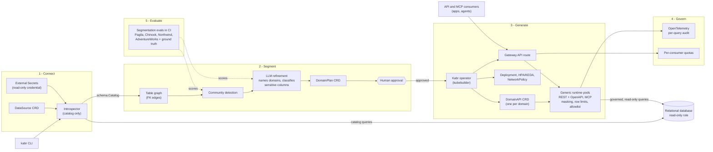
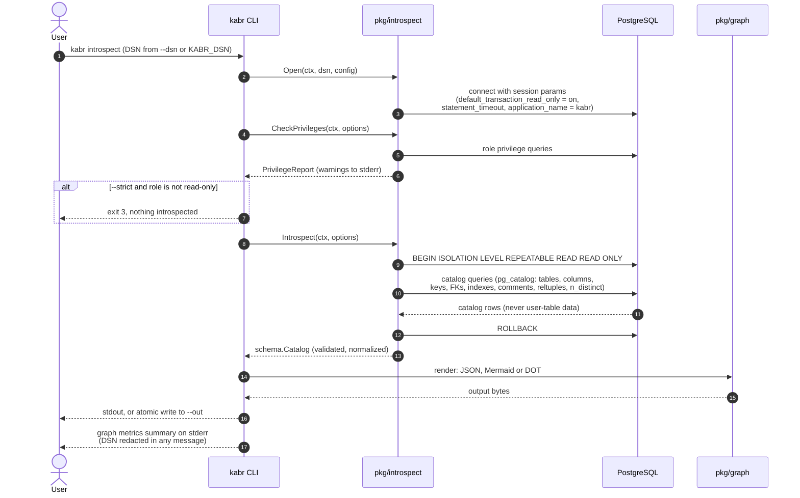
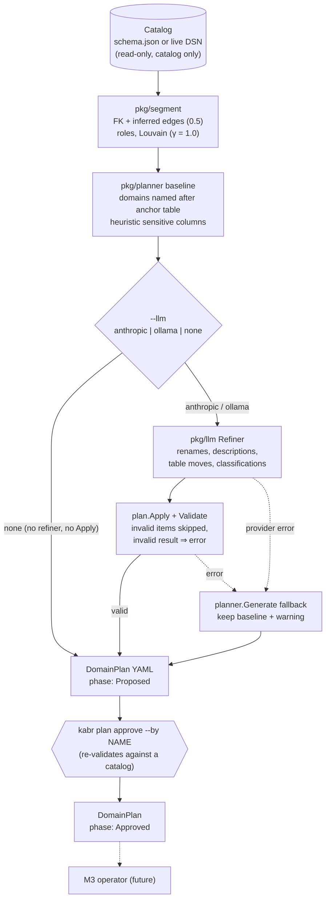

# Architecture

Kabr turns a relational database into governed, per-domain APIs in five
stages: **Connect, Segment, Generate, Govern, Evaluate**. This document
describes the target system, then states plainly what exists today.

> Most of this document is the **target design**. Milestones M1 (catalog
> introspection and the table graph) and M2 (segmentation into a
> `DomainPlan` with human approval) are implemented. See
> [What exists today (M1, M2)](#what-exists-today-m1-m2) before relying on
> any component.

## Target system

### Components

| Component | Stage | Role |
|-----------|-------|------|
| `kabr` CLI | 1-2 | Runs introspection and segmentation (`kabr plan`) outside the cluster, for local use and CI. Built on the standard library `flag` package; see [ADR 0003](adr/0003-cli-framework.md). |
| Introspector | 1 | Reads only the database catalog with a read-only session and transaction; produces a `schema.Catalog`. See [ADR 0002](adr/0002-catalog-only-read-only-access.md). |
| `DataSource` CRD | 1 | Declares a database and points at a read-only credential delivered by External Secrets. |
| Table graph | 2 | Tables as nodes, foreign keys as weighted edges; input for community detection. |
| Segmenter + LLM | 2 | Community detection proposes clusters; an LLM refines boundaries, names domains and flags sensitive columns (PII, secrets). Only allowlisted catalog metadata is sent, never rows. See [ADR 0004](adr/0004-segmentation-baseline-llm-approval.md) and [ADR 0005](adr/0005-llm-providers-metadata-only.md). |
| `DomainPlan` | 2 | The proposed segmentation (`kabr.dev/v1alpha1`, YAML today, a CRD once the operator lands). Nothing is generated until a human approves it. |
| Operator | 3 | Go operator (kubebuilder) that turns an approved plan into one `DomainAPI` per domain and owns its Kubernetes objects. |
| `DomainAPI` pods | 3 | A generic runtime configured by the plan (no dynamic code generation): REST with OpenAPI, an MCP server, per-column masking, row limits and an allowlist of tables and columns. |
| Gateway | 3-4 | Gateway API route per domain; the entry point for consumers. |
| OTel / audit | 4 | Every query is traced and audited through OpenTelemetry. |
| Quotas | 4 | Per-consumer limits enforced at the edge. |
| Evals | 5 | CI scores segmentation against sample databases with hand-labeled domains. |

## What exists today (M1, M2)

Implemented and tested:

- **`pkg/schema`**: the canonical, versioned catalog model (tables, columns,
  keys, foreign keys, indexes, unique constraints, comments, planner
  statistics limited to row estimates and `n_distinct`), with validation,
  deterministic normalization and JSON round-tripping.
- **`pkg/graph`**: the directed table graph built from a catalog (degrees,
  weakly connected components, orphans, an undirected weighted adjacency for
  future community detection) plus deterministic Mermaid ER and Graphviz DOT
  exporters.
- **Demo database** (`deploy/compose/`): PostgreSQL 17 with Pagila and two
  roles, `kabr_reader` (read-only) and `kabr_unsafe` (over-privileged, to
  exercise the least-privilege warning).
- **CI** (`.github/workflows/ci.yml`): vet, gofmt, golangci-lint, unit and
  integration tests with the race detector, and `govulncheck`.

- **`pkg/introspect`**: the PostgreSQL introspector (pgx v5). The session is
  opened with `default_transaction_read_only = on` and every run executes in a
  `REPEATABLE READ READ ONLY` transaction that is always rolled back. It
  queries only system catalogs; this is proven by a static test over the
  query text and by an integration test that revokes `SELECT` on the user
  tables and still introspects successfully. `CheckPrivileges` reports roles
  that can write or create, and DSNs and passwords are redacted from every
  error. Integration tests run against real PostgreSQL through
  testcontainers.
- **`kabr introspect`** (`internal/cli`, `cmd/kabr`): the CLI command that
  wires the introspector, the graph and the exporters together. It reads the
  DSN from `--dsn` or `KABR_DSN`, supports `--format json|mermaid|dot`, writes
  the output atomically with `--out`, and exits with code 3 under `--strict`
  when the role has privileges beyond read-only.

- **Segmentation (M2)**: `pkg/segment`, `pkg/planner`, `pkg/llm`,
  `pkg/plan`, `pkg/eval` and the `kabr plan` commands, described in
  [Segment stage (M2)](#segment-stage-m2) below. The Pagila gold standard
  in `evals/pagila/gold.yaml` is scored in the unit tests as a regression
  gate.

Not started (roadmap): the operator and `DomainAPI` REST runtime (M3), MCP,
audit and quotas (M4), multi-dataset evals in CI (M5), an end-to-end kind
demo (M6). There are no CRDs installed in a cluster and no operator yet; the
`DomainPlan` exists as a YAML document with a published JSON Schema.

### Package map

| Package | Milestone | Role |
|---------|-----------|------|
| `pkg/schema` | M1 | Canonical, versioned catalog model (JSON). |
| `pkg/introspect`, `pkg/introspect/postgres` | M1 | Read-only, catalog-only introspection; privilege check; DSN redaction. |
| `pkg/graph` | M1 | Table graph, metrics, Mermaid and DOT exporters. |
| `pkg/segment` | M2 | Deterministic Louvain segmentation of the table graph (FK edges plus name-inferred edges), table roles, rationales. |
| `pkg/planner` | M2 | Baseline `DomainPlan` from the segmentation plus the heuristic sensitive-column classifier; optional refinement with fallback. |
| `pkg/llm` | M2 | `Refiner` implementations (Anthropic, Ollama), metadata-only prompt builder, strict response parser. |
| `pkg/plan` | M2 | `DomainPlan` types, strict YAML decoding, validation, catalog fingerprint, `Apply`, `Approve`. |
| `pkg/eval` | M2 | Scores a plan against a gold standard: pairwise F1, ARI, sensitive-column recall/precision. |
| `api/v1alpha1` | M2 | Published JSON Schema of the `DomainPlan` document. |
| `internal/cli`, `cmd/kabr` | M1-M2 | `kabr introspect` and `kabr plan` commands. |

## `kabr introspect` flow

The M1 flow as implemented. The read-only guarantees are specified in
[ADR 0002](adr/0002-catalog-only-read-only-access.md).

## Segment stage (M2)

The M2 flow as implemented. Design decisions are in
[ADR 0004](adr/0004-segmentation-baseline-llm-approval.md) (pipeline) and
[ADR 0005](adr/0005-llm-providers-metadata-only.md) (providers and privacy).

1. **Catalog.** Either an M1 `schema.json` (`--catalog`) or a live
   introspection (`--dsn` / `KABR_DSN`) with the same read-only guarantees as
   `kabr introspect`.
2. **Segment.** `pkg/segment` builds the weighted undirected graph (one unit
   per foreign key, 0.5 per name-inferred reference), assigns roles
   (junction, lookup, orphan, core) and runs deterministic Louvain on the
   core tables at resolution γ (`--resolution`, default 1.0).
3. **Baseline.** `pkg/planner` maps each community to a domain named after
   its anchor table, puts orphans in `unassigned`, and flags sensitive
   columns from column-name tokens and types (`source: heuristic`). The
   baseline is always valid.
4. **Refine (optional).** A `Refiner` proposes a `plan.Refinement`.
   `plan.Apply` checks every item against the catalog, skips invalid ones
   with a warning, and returns an error if the result does not validate.
   The fallback lives in `planner.Generate`: on a provider error or an
   `Apply` error it keeps the baseline and adds a warning. With
   `--llm none` no refiner runs and `Apply` is not called.
5. **Validate.** Strict decoding (exact-case keys, single YAML document,
   unknown fields rejected); every catalog table in exactly one domain;
   DNS-1123 domain names; sensitive columns exist and belong to their
   domain; the structural catalog fingerprint (sha256, ignoring statistics
   and comments) matches. Any change made through `Apply` resets approval.
6. **Approve.** `kabr plan approve FILE --by NAME` always re-validates the
   plan against a catalog, which is required (`--catalog`, `--dsn` or
   `KABR_DSN`): structure, coverage of every catalog table and the catalog
   fingerprint. Only a valid plan gets `status.phase: Approved` with
   `approvedBy` and `approvedAt`; otherwise it exits 1 and leaves the file
   untouched. `kabr plan validate` without a catalog checks the structure
   only. The M3 operator will consume approved plans only.

### Trust boundaries

What crosses to the LLM provider, and nothing else:

- table IDs and table comments;
- column name, data type, nullability and comment;
- primary key columns, foreign key columns with referenced table and
  columns, unique constraint columns;
- the baseline: domain names and, per table, its ID, role and shared flag.

Never sent: row data (never read), column defaults, statistics (row
estimates, `n_distinct`), index definitions, constraint names, the database
name, the DSN or any credential, baseline rationales. An allowlist test over
every JSON key of the prompt and sentinel-value tests enforce this. Comments
are sent verbatim; operators who treat schema text as sensitive should use
`--llm ollama` (local) or `--llm none`.
