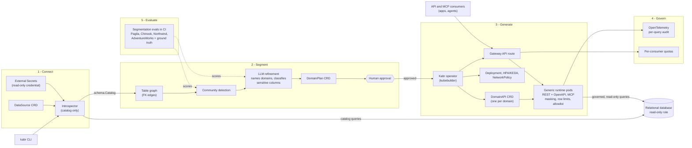
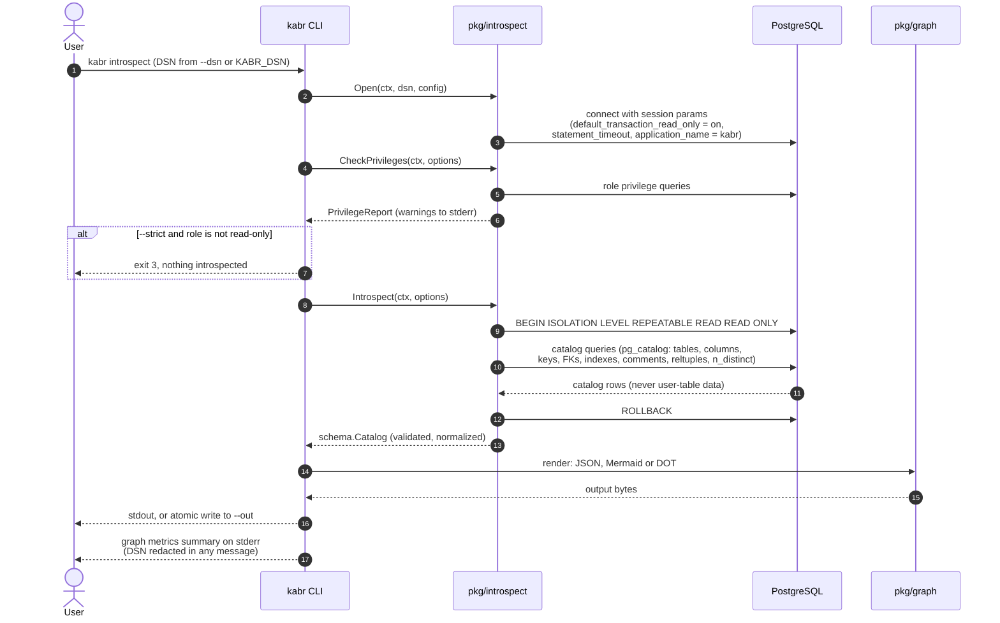
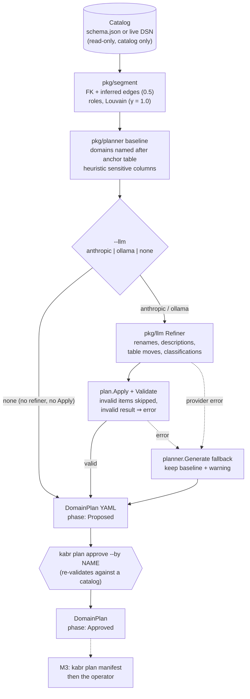
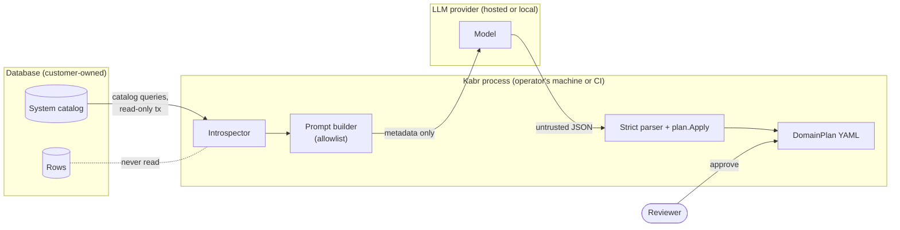
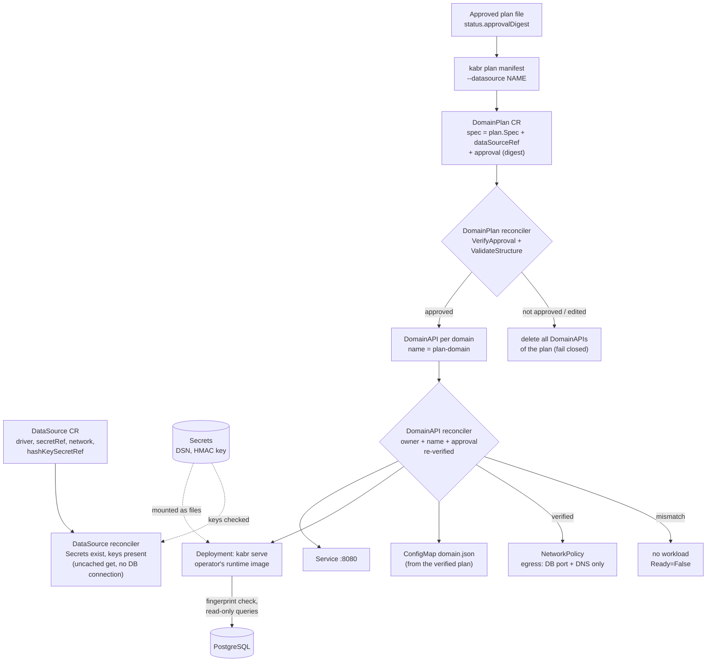
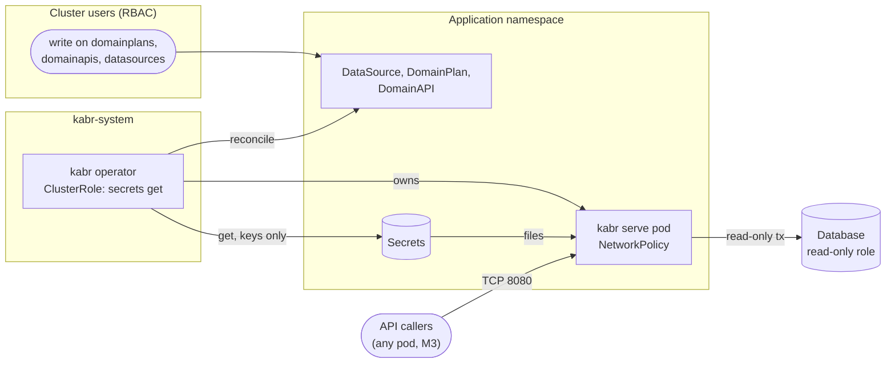

# Architecture

Kabr turns a relational database into governed, per-domain APIs in five
stages: **Connect, Segment, Generate, Govern, Evaluate**. This document
describes the target system, then states plainly what exists today.

> Most of this document is the **target design**. Milestones M1 (catalog
> introspection and the table graph), M2 (segmentation into a `DomainPlan`
> with human approval) and M3 (the Kubernetes operator and the read-only
> REST runtime per domain) are implemented. See
> [What exists today (M1-M3)](#what-exists-today-m1-m3) before relying on
> any component.

## Target system

### Components

| Component | Stage | Role |
|-----------|-------|------|
| `kabr` CLI | 1-2 | Runs introspection and segmentation (`kabr plan`) outside the cluster, for local use and CI. Built on the standard library `flag` package; see [ADR 0003](adr/0003-cli-framework.md). |
| Introspector | 1 | Reads only the database catalog with a read-only session and transaction; produces a `schema.Catalog`. See [ADR 0002](adr/0002-catalog-only-read-only-access.md). |
| `DataSource` CRD | 1 | Declares a database, its network endpoint and the Secret holding a read-only DSN. Implemented in M3; the Secret can come from any source (External Secrets integration is not built in). |
| Table graph | 2 | Tables as nodes, foreign keys as weighted edges; input for community detection. |
| Segmenter + LLM | 2 | Community detection proposes clusters; an LLM refines boundaries, names domains and flags sensitive columns (PII, secrets). Only allowlisted catalog metadata is sent, never rows. See [ADR 0004](adr/0004-segmentation-baseline-llm-approval.md) and [ADR 0005](adr/0005-llm-providers-metadata-only.md). |
| `DomainPlan` | 2 | The segmentation (`kabr.dev/v1alpha1`): a YAML file for review and approval, and a CRD (rendered by `kabr plan manifest`) once approved. Nothing is generated until a human approves it. |
| Operator | 3 | Go operator (controller-runtime) that turns an approved plan into one `DomainAPI` per domain and owns its Kubernetes objects. See [ADR 0006](adr/0006-operator-and-crd-model.md). |
| `DomainAPI` pods | 3 | A generic runtime configured by the plan (no dynamic code generation): REST with OpenAPI (M3), an MCP server (M4), per-column masking, row limits and an allowlist of tables and columns. See [ADR 0007](adr/0007-runtime-query-safety.md). |
| Gateway | 3-4 | Gateway API route per domain; the entry point for consumers. |
| OTel / audit | 4 | Every query is traced and audited through OpenTelemetry. |
| Quotas | 4 | Per-consumer limits enforced at the edge. |
| Evals | 5 | CI scores segmentation against sample databases with hand-labeled domains. |

## What exists today (M1-M3)

Implemented and tested:

- **`pkg/schema`**: the canonical, versioned catalog model (tables, columns,
  keys, foreign keys, indexes, unique constraints, comments, planner
  statistics limited to row estimates and `n_distinct`), with validation,
  deterministic normalization and JSON round-tripping.
- **`pkg/graph`**: the directed table graph built from a catalog (degrees,
  weakly connected components, orphans, an undirected weighted adjacency for
  future community detection) plus deterministic Mermaid ER and Graphviz DOT
  exporters.
- **Demo database** (`deploy/compose/`): PostgreSQL 17 with Pagila and two
  roles, `kabr_reader` (read-only) and `kabr_unsafe` (over-privileged, to
  exercise the least-privilege warning).
- **CI** (`.github/workflows/ci.yml`): vet, gofmt, golangci-lint, a check
  that generated code and manifests are up to date, unit and integration
  tests with the race detector, the Pagila eval, envtest and `govulncheck`.

- **`pkg/introspect`**: the PostgreSQL introspector (pgx v5). The session is
  opened with `default_transaction_read_only = on` and every run executes in a
  `REPEATABLE READ READ ONLY` transaction that is always rolled back. It
  queries only system catalogs; this is proven by a static test over the
  query text and by an integration test that revokes `SELECT` on the user
  tables and still introspects successfully. `CheckPrivileges` reports roles
  that can write or create, and DSNs and passwords are redacted from every
  error. Integration tests run against real PostgreSQL through
  testcontainers.
- **`kabr introspect`** (`internal/cli`, `cmd/kabr`): the CLI command that
  wires the introspector, the graph and the exporters together. It reads the
  DSN from `--dsn` or `KABR_DSN`, supports `--format json|mermaid|dot`, writes
  the output atomically with `--out`, and exits with code 3 under `--strict`
  when the role has privileges beyond read-only.

- **Segmentation (M2)**: `pkg/segment`, `pkg/planner`, `pkg/llm`,
  `pkg/plan`, `pkg/eval` and the `kabr plan` commands, described in
  [Segment stage (M2)](#segment-stage-m2) below. The Pagila gold standard
  in `evals/pagila/gold.yaml` is scored in the unit tests as a regression
  gate.

- **Operator and runtime (M3)**: the `kabr.dev/v1alpha1` CRDs
  (`DataSource`, `DomainPlan`, `DomainAPI`), `kabr plan manifest`, the
  approval digest, `kabr operator` and `kabr serve`, described in
  [Generate stage (M3)](#generate-stage-m3) below. They are tested with
  unit tests, integration tests against real PostgreSQL, envtest (a real
  kube-apiserver and etcd) and an end-to-end test on a kind cluster
  (`make e2e`), all in CI.

Not built yet (roadmap, M4 and later):

- MCP server per domain; per-consumer quotas; OpenTelemetry per-query
  audit; Gateway API routes; HPA/KEDA autoscaling.
- Admission webhooks; signed plan approvals (the digest is integrity, not
  authentication); a namespaced RBAC mode for the operator (today a
  ClusterRole with `get` on Secrets).
- Tightening ingress to the API pods (open on TCP 8080 in the cluster);
  authentication of the optional operator metrics endpoint.
- A Helm chart; images published to a registry (today they are built
  locally with `make docker-build`).
- Databases other than PostgreSQL; multi-dataset evals in CI (M5).

### Package map

| Package | Milestone | Role |
|---------|-----------|------|
| `pkg/schema` | M1 | Canonical, versioned catalog model (JSON). |
| `pkg/introspect`, `pkg/introspect/postgres` | M1 | Read-only, catalog-only introspection; privilege check; DSN redaction. |
| `pkg/graph` | M1 | Table graph, metrics, Mermaid and DOT exporters. |
| `pkg/segment` | M2 | Deterministic Louvain segmentation of the table graph (FK edges plus name-inferred edges), table roles, rationales. |
| `pkg/planner` | M2 | Baseline `DomainPlan` from the segmentation plus the heuristic sensitive-column classifier; optional refinement with fallback. |
| `pkg/llm` | M2 | `Refiner` implementations (Anthropic, Ollama), metadata-only prompt builder, strict response parser. |
| `pkg/plan` | M2 | `DomainPlan` types, strict YAML decoding, validation, catalog fingerprint, `Apply`, `Approve`. |
| `pkg/eval` | M2 | Scores a plan against a gold standard: pairwise F1, ARI, sensitive-column recall/precision. |
| `pkg/plan` (digest) | M3 | `SpecDigest`, `VerifyApproval`: the approval digest over the canonical spec. |
| `api/v1alpha1` | M2-M3 | Published JSON Schema of the `DomainPlan` document (M2); Go types of the `DataSource`, `DomainPlan` and `DomainAPI` CRDs and the plan file conversion (M3). |
| `pkg/serve` | M3 | `kabr serve`: read-only REST runtime of one domain (config, catalog gate, SQL builder, handlers, OpenAPI). |
| `internal/controller` | M3 | Reconcilers of the three kinds and the rendering of the per-domain workload. |
| `internal/cli`, `cmd/kabr` | M1-M3 | `kabr introspect`, `kabr plan` (including `manifest`), `kabr serve` and `kabr operator`. |
| `config/`, `deploy/kind/` | M3 | Generated CRDs and RBAC, the operator kustomization, the local kind demo. |

## `kabr introspect` flow

The M1 flow as implemented. The read-only guarantees are specified in
[ADR 0002](adr/0002-catalog-only-read-only-access.md).

## Segment stage (M2)

The M2 flow as implemented. Design decisions are in
[ADR 0004](adr/0004-segmentation-baseline-llm-approval.md) (pipeline) and
[ADR 0005](adr/0005-llm-providers-metadata-only.md) (providers and privacy).

1. **Catalog.** Either an M1 `schema.json` (`--catalog`) or a live
   introspection (`--dsn` / `KABR_DSN`) with the same read-only guarantees as
   `kabr introspect`.
2. **Segment.** `pkg/segment` builds the weighted undirected graph (one unit
   per foreign key, 0.5 per name-inferred reference), assigns roles
   (junction, lookup, orphan, core) and runs deterministic Louvain on the
   core tables at resolution γ (`--resolution`, default 1.0).
3. **Baseline.** `pkg/planner` maps each community to a domain named after
   its anchor table, puts orphans in `unassigned`, and flags sensitive
   columns from column-name tokens and types (`source: heuristic`). The
   baseline is always valid.
4. **Refine (optional).** A `Refiner` proposes a `plan.Refinement`.
   `plan.Apply` checks every item against the catalog, skips invalid ones
   with a warning, and returns an error if the result does not validate.
   The fallback lives in `planner.Generate`: on a provider error or an
   `Apply` error it keeps the baseline and adds a warning. With
   `--llm none` no refiner runs and `Apply` is not called.
5. **Validate.** Strict decoding (exact-case keys, single YAML document,
   unknown fields rejected); every catalog table in exactly one domain;
   DNS-1123 domain names; sensitive columns exist and belong to their
   domain; the structural catalog fingerprint (sha256, ignoring statistics
   and comments) matches. Any change made through `Apply` resets approval.
6. **Approve.** `kabr plan approve FILE --by NAME` always re-validates the
   plan against a catalog, which is required (`--catalog`, `--dsn` or
   `KABR_DSN`): structure, coverage of every catalog table and the catalog
   fingerprint. Only a valid plan gets `status.phase: Approved` with
   `approvedBy` and `approvedAt`; otherwise it exits 1 and leaves the file
   untouched. Approval also records `status.approvalDigest`, the digest of
   the approved spec (see [Generate stage (M3)](#generate-stage-m3)).
   `kabr plan validate` without a catalog checks the structure only. The
   M3 operator consumes approved plans only.

### Trust boundaries

What crosses to the LLM provider, and nothing else:

- table IDs and table comments;
- column name, data type, nullability and comment;
- primary key columns, foreign key columns with referenced table and
  columns, unique constraint columns;
- the baseline: domain names and, per table, its ID, role and shared flag.

Never sent: row data (never read), column defaults, statistics (row
estimates, `n_distinct`), index definitions, constraint names, the database
name, the DSN or any credential, baseline rationales. An allowlist test over
every JSON key of the prompt and sentinel-value tests enforce this. Comments
are sent verbatim; operators who treat schema text as sensitive should use
`--llm ollama` (local) or `--llm none`.

## Generate stage (M3)

The M3 flow as implemented. Design decisions are in
[ADR 0006](adr/0006-operator-and-crd-model.md) (operator and CRDs) and
[ADR 0007](adr/0007-runtime-query-safety.md) (runtime query safety).

1. **Approve and render.** `kabr plan approve` records the approval digest;
   `kabr plan manifest` refuses a plan whose approval does not verify and
   prints the `DomainPlan` custom resource, bound to a `DataSource` by name.
2. **DataSource.** The reconciler checks the driver, that the network names
   CIDRs (never `/0`) or a pod selector, and that the referenced Secrets
   exist and hold the referenced keys. Secrets are read with an uncached
   `get`, keys only, and re-checked periodically. The operator never
   connects to the database.
3. **DomainPlan.** Re-verifies the approval digest and the plan structure.
   Approved: one `DomainAPI` per domain, owned by the plan. Not approved,
   edited after approval or invalid: every DomainAPI of the plan is deleted
   and a Warning event is emitted.
4. **DomainAPI.** Re-verifies the owning plan (controller owner reference,
   expected name, domain present, approval valid) and renders the runtime
   config from that plan, not from the DomainAPI's own copy. It then writes
   the NetworkPolicy first, then the ConfigMap, Service and Deployment. The
   pods run the operator's runtime image; a DomainAPI has no image field.
5. **Runtime.** Each pod runs `kabr serve --config /etc/kabr/domain.json`
   with the DSN mounted from a Secret as a file (and the HMAC key, only
   when the domain hashes a non-credential column and the DataSource names
   a hash key). It verifies the live catalog fingerprint before
   serving and stays NotReady (503) on drift, missing tables or missing
   privileges.

### Runtime endpoints

| Endpoint | Purpose |
|----------|---------|
| `GET /v1/{schema}/{table}` | List rows: keyset pagination on the primary key (`?limit=`, `?cursor=`), equality filters (`?column=value`, ANDed) on non-sensitive columns. |
| `GET /v1/{schema}/{table}/{pk}` | One row by primary key (single-column keys only). |
| `GET /openapi.json` | OpenAPI 3.0.3 document of the served tables and columns. |
| `GET /healthz` | Liveness. |
| `GET /readyz` | Readiness: database reachable and catalog fingerprint unchanged; on failure only a coarse category is disclosed. |

### Trust boundaries (M3)

- Anyone with write access to `domainplans` can approve a plan in effect:
  the digest detects edits after approval, but it can be recomputed. RBAC
  on the Kabr kinds and on Secrets is the access control.
- The operator reads Secrets only to check that the referenced keys are
  present (uncached `get`, never watched, cached or logged) and never talks
  to the database; only the runtime pods do.
- Callers are not authenticated in M3 and ingress to the pods is open on
  TCP 8080; Gateway API, quotas and audit are M4. NetworkPolicies are only
  as good as the CNI that enforces them.
