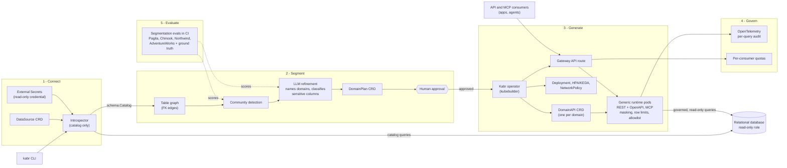
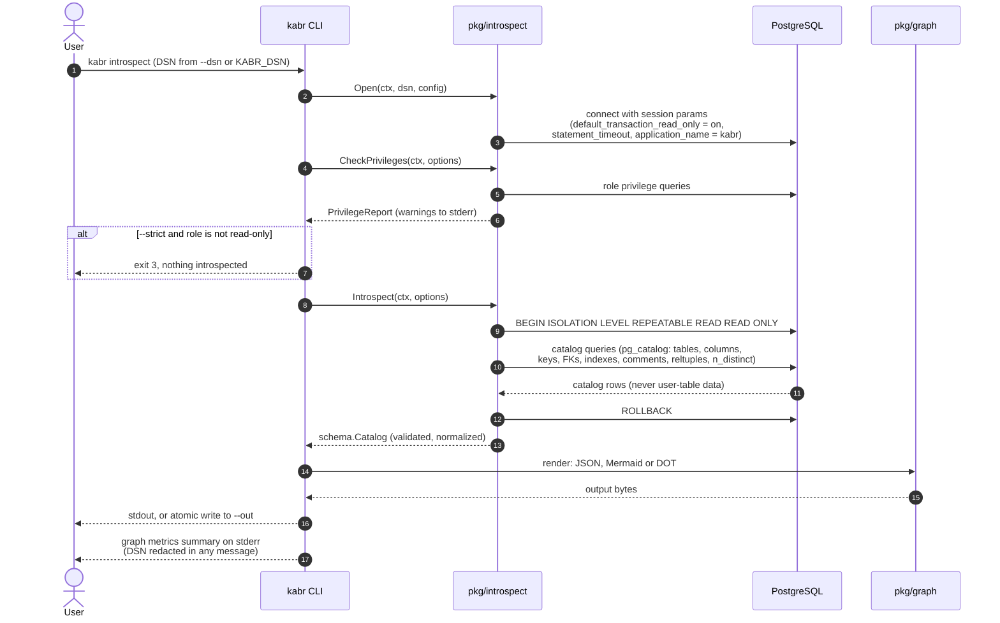

# Architecture

Kabr turns a relational database into governed, per-domain APIs in five
stages: **Connect, Segment, Generate, Govern, Evaluate**. This document
describes the target system, then states plainly what exists today.

> Most of this document is the **target design**. Milestone M1 (catalog
> introspection and the table graph) is the only one implemented. See
> [What exists today (M1)](#what-exists-today-m1) before relying on any
> component.

## Target system

### Components

| Component | Stage | Role |
|-----------|-------|------|
| `kabr` CLI | 1-2 | Runs introspection (and later segmentation) outside the cluster, for local use and CI. Built on the standard library `flag` package; see [ADR 0003](adr/0003-cli-framework.md). |
| Introspector | 1 | Reads only the database catalog with a read-only session and transaction; produces a `schema.Catalog`. See [ADR 0002](adr/0002-catalog-only-read-only-access.md). |
| `DataSource` CRD | 1 | Declares a database and points at a read-only credential delivered by External Secrets. |
| Table graph | 2 | Tables as nodes, foreign keys as weighted edges; input for community detection. |
| Segmenter + LLM | 2 | Community detection proposes clusters; an LLM refines boundaries, names domains and flags sensitive columns (PII, secrets). Only the catalog is sent, never rows. |
| `DomainPlan` CRD | 2 | The proposed segmentation. Nothing is generated until a human approves it. |
| Operator | 3 | Go operator (kubebuilder) that turns an approved plan into one `DomainAPI` per domain and owns its Kubernetes objects. |
| `DomainAPI` pods | 3 | A generic runtime configured by the plan (no dynamic code generation): REST with OpenAPI, an MCP server, per-column masking, row limits and an allowlist of tables and columns. |
| Gateway | 3-4 | Gateway API route per domain; the entry point for consumers. |
| OTel / audit | 4 | Every query is traced and audited through OpenTelemetry. |
| Quotas | 4 | Per-consumer limits enforced at the edge. |
| Evals | 5 | CI scores segmentation against sample databases with hand-labeled domains. |

## What exists today (M1)

Implemented and tested:

- **`pkg/schema`**: the canonical, versioned catalog model (tables, columns,
  keys, foreign keys, indexes, unique constraints, comments, planner
  statistics limited to row estimates and `n_distinct`), with validation,
  deterministic normalization and JSON round-tripping.
- **`pkg/graph`**: the directed table graph built from a catalog (degrees,
  weakly connected components, orphans, an undirected weighted adjacency for
  future community detection) plus deterministic Mermaid ER and Graphviz DOT
  exporters.
- **Demo database** (`deploy/compose/`): PostgreSQL 17 with Pagila and two
  roles, `kabr_reader` (read-only) and `kabr_unsafe` (over-privileged, to
  exercise the least-privilege warning).
- **CI** (`.github/workflows/ci.yml`): vet, gofmt, golangci-lint, unit and
  integration tests with the race detector, and `govulncheck`.

- **`pkg/introspect`**: the PostgreSQL introspector (pgx v5). The session is
  opened with `default_transaction_read_only = on` and every run executes in a
  `REPEATABLE READ READ ONLY` transaction that is always rolled back. It
  queries only system catalogs; this is proven by a static test over the
  query text and by an integration test that revokes `SELECT` on the user
  tables and still introspects successfully. `CheckPrivileges` reports roles
  that can write or create, and DSNs and passwords are redacted from every
  error. Integration tests run against real PostgreSQL through
  testcontainers.
- **`kabr introspect`** (`internal/cli`, `cmd/kabr`): the CLI command that
  wires the introspector, the graph and the exporters together. It reads the
  DSN from `--dsn` or `KABR_DSN`, supports `--format json|mermaid|dot`, writes
  the output atomically with `--out`, and exits with code 3 under `--strict`
  when the role has privileges beyond read-only.

Not started (roadmap): segmentation and the LLM (M2), the `DomainPlan` and
human approval (M2), the operator and `DomainAPI` REST runtime (M3), MCP,
audit and quotas (M4), evals in CI (M5), an end-to-end kind demo (M6). There
are no CRDs, no operator and no LLM calls in the repository yet.

## `kabr introspect` flow

The M1 flow as implemented. The read-only guarantees are specified in
[ADR 0002](adr/0002-catalog-only-read-only-access.md).

